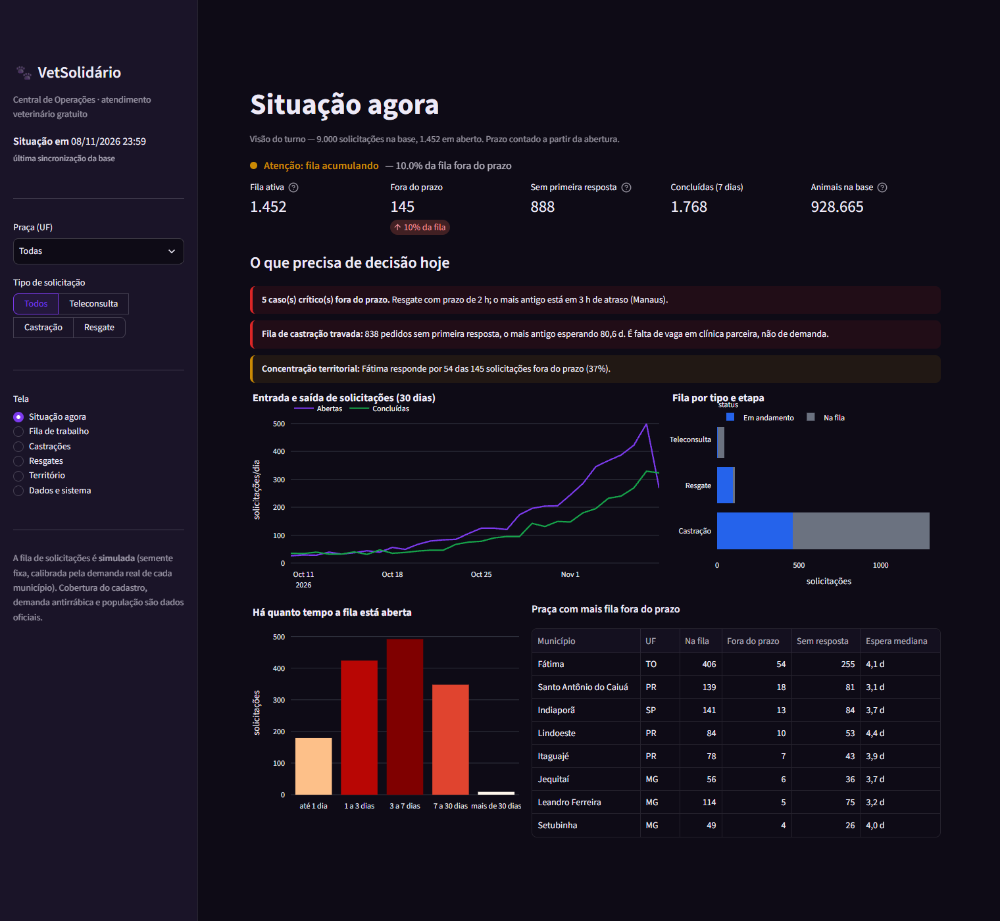
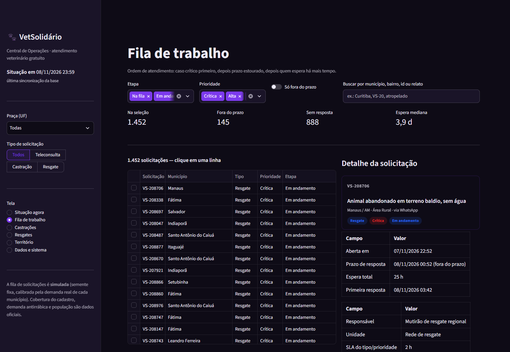
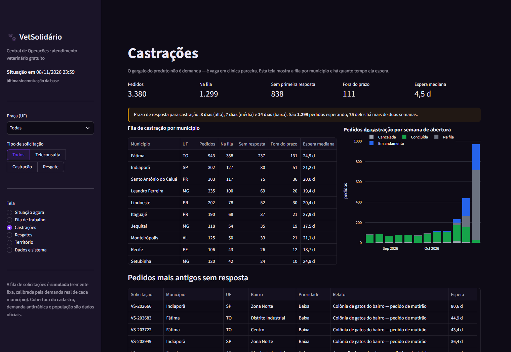
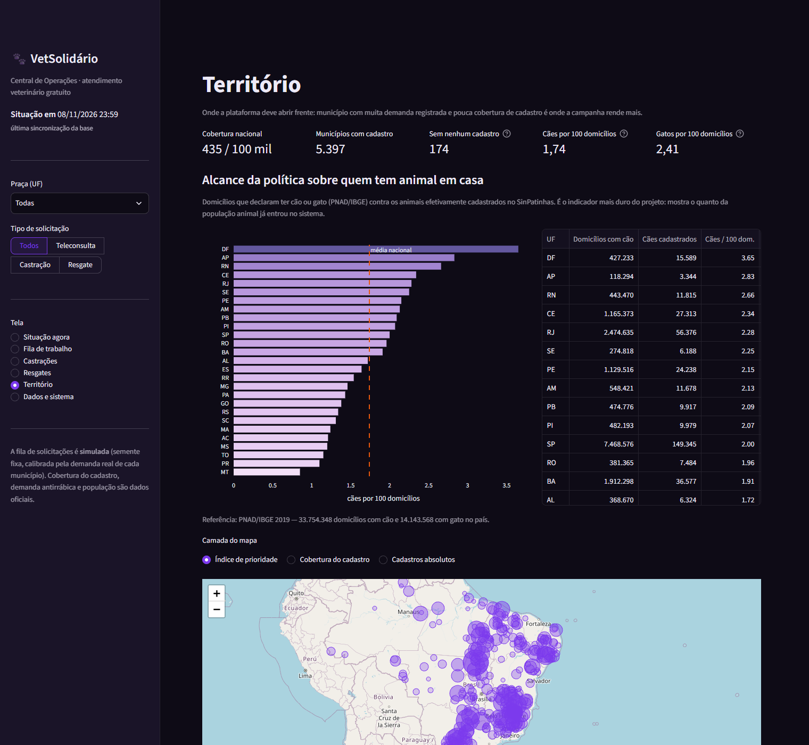

# VetSolidário — Central de Operações

Plataforma de teleconsulta, castração e resgate de animais, com painel operacional
para quem atende e base territorial para decidir onde abrir frente.

Projeto da **FIAP Global Solution 2026.2 — CitizenTech**.

---

## O problema

O Brasil não tinha, até 2025, um registro de quantos cães e gatos vivem em cada
município. Sem denominador, política de castração, campanha de vacinação e
dimensionamento de atendimento veterinário são decididos no escuro.

O **SinPatinhas** — Cadastro Nacional de Animais Domésticos, criado pela
**Lei 15.046/2024** — começou a preencher essa lacuna em abril de 2025. Cada
animal cadastrado tem município, espécie, idade, sexo e pelagem. O volume por
município mede **adesão à política pública**: onde o cadastro avança, castração
e microchipagem chegam junto.

## As duas camadas do projeto

| Camada | Para quem | Onde está |
|---|---|---|
| **Operação** — fila, prazo, castração, resgate, território | o atendente que abre o sistema no turno | `app.py` (6 telas) |
| **Análise** — descritiva, testes, probabilidade, correlação, agrupamento | a banca e o time de dados | `notebooks/analise_vetsolidario.ipynb` |

A separação é intencional: o painel do operador não mostra gráfico de dispersão —
mostra o que decidir agora.

## Telas do painel

| Tela | Pergunta que responde |
|---|---|
| **Situação agora** | Como está a fila neste momento? O que estourou o prazo? |
| **Fila de trabalho** | Qual caso atender primeiro? (ordem por criticidade, atraso e espera) |
| **Castrações** | Quantos pedidos esperam vaga e há quanto tempo? |
| **Resgates** | Onde estão os casos ativos e quem está em campo? |
| **Território** | Onde a política chegou e onde não chegou — cobertura, alcance e prioridade |
| **Dados e sistema** | O que alimenta o painel, o que é oficial e o que é demonstração |

A **Fila de trabalho** é operável: dá para assumir, concluir, cancelar ou devolver
uma solicitação à fila (as ações valem para a sessão, não alteram a base).

| Situação agora | Fila de trabalho |
|---|---|
|  |  |

| Castrações | Território |
|---|---|
|  |  |

## O que o painel mostra hoje

Base de demonstração: **9.000 solicitações** em 22 municípios-piloto, com ciclo de
vida completo (abertura → primeira resposta → conclusão), prazo por tipo e
prioridade, responsável e unidade.

| Indicador | Valor |
|---|---|
| Fila ativa | **1.452** solicitações |
| Fora do prazo | **145** (10,0%) |
| Sem primeira resposta | **888** — quase todas castrações |
| Concluídas nos últimos 7 dias | **1.768** |
| Espera mediana na fila | **3,9 dias** |

**O gargalo que o painel expõe:** 1.299 pedidos de castração em fila, 838 deles
sem nenhuma resposta e 75 esperando há mais de duas semanas. Não é falta de
demanda — é falta de vaga em clínica parceira.

## O que os dados oficiais mostram

| Indicador | Valor |
|---|---|
| Animais cadastrados no SinPatinhas | **928.665** (587.458 cães, 341.207 gatos) |
| Municípios com cadastro | **5.397** — 174 sem nenhum registro |
| Período coberto | 15/04/2025 a 02/12/2025 |
| Cobertura nacional | **435 por 100 mil habitantes** |
| **Cães por 100 domicílios com cão** | **1,74** |
| **Gatos por 100 domicílios com gato** | **2,41** |
| Domicílios com cão no país (PNAD 2019) | 33.754.348 |
| Domicílios com gato no país (PNAD 2019) | 14.143.568 |

**O número que dimensiona o problema:** o Brasil tem 33,8 milhões de lares com cão
e o cadastro alcançou **menos de 2% deles**. Distrito Federal lidera (3,65 cães por
100 domicílios), Mato Grosso está na lanterna (0,85). O VetSolidário existe para
fechar essa distância com campo — não só com aplicativo.

## Stack

Python 3.12 · Pandas · NumPy · Matplotlib/Seaborn · Plotly · Streamlit · Folium ·
SciPy · Scikit-Learn · pyarrow · requests (APIs IBGE/SIDRA, Base dos Dados)

## Estrutura

```
VetSolidario/
├── app.py                     # central de operações, 6 telas
├── src/
│   ├── sinpatinhas.py         # download do SinPatinhas (Base dos Dados)
│   ├── processar_cadastros.py # limpeza, indicadores municipais  ← esteira principal
│   ├── pnad_animais.py        # domicílios com cão/gato (SIDRA 4930/4931)
│   ├── resumo.py              # KPIs e alcance sobre domicílios
│   ├── plataforma.py          # fila operacional simulada (calibrada e rotulada)
│   ├── processar_antr.py      # SINAN/atendimento antirrábico
│   ├── sinan.py               # FTP DATASUS -> DBC -> DBF
│   ├── dicionarios.py         # dicionário de campos do SINAN
│   ├── ibge.py                # população (API IBGE)
│   └── dim_municipios.py      # 5.571 municípios com coordenadas
├── dados/{brutos,processados}/
├── notebooks/analise_vetsolidario.ipynb
├── tests/test_smoke.py        # percorre as 6 telas
├── FONTES_DE_DADOS.md
└── PLANO.md
```

## Como executar

```bash
python -m venv .venv
.venv\Scripts\activate
pip install -r requirements.txt

python src/processar_antr.py        # opcional — demanda (SINAN, FTP DATASUS)
python src/processar_cadastros.py   # baixa o SinPatinhas e gera os indicadores
python src/pnad_animais.py          # domicílios com cão/gato (SIDRA)
python src/resumo.py                # KPIs e alcance
python src/plataforma.py --total 9000
streamlit run app.py
```

## Dados

| Fonte | Natureza | Uso |
|---|---|---|
| SinPatinhas (MMA, via Base dos Dados) | oficial | cadastro de animais por município |
| PNAD/SIDRA 4930 e 4931 (IBGE) | oficial | domicílios com cão e com gato |
| SINAN — Atendimento Antirrábico | oficial | demanda por atendimento |
| IBGE — população e localidades | oficial | denominador e geografia |
| Fila de solicitações da plataforma | **simulada** | operação do produto |

Inventário completo com URLs e volumes: [`FONTES_DE_DADOS.md`](FONTES_DE_DADOS.md).

## Ética e LGPD

- O SinPatinhas tem dados do tutor na origem; a tabela publicada **não traz nenhum
  dado pessoal** — só município, animal e atributos do animal.
- Todas as telas mostram agregados, nenhum registro individual de tutor.
- A fila operacional é **simulada**, com semente fixa, calibrada pela demanda real,
  e sinalizada no app, no README e no notebook.
- A PNAD é pesquisa amostral do IBGE, agregada por UF.

## Limitações

- O SinPatinhas registra **animais cadastrados**, não atendimentos: os volumes da
  fila operacional são simulados.
- A PNAD não é representativa em nível municipal (só capitais): o alcance é
  comparado por UF.
- Série curta do cadastro (nove meses de política em implantação).
- Sem renda e saneamento não se separa adesão de capacidade administrativa.

## Divisão do grupo (FIAP GS 2026.2)

| Frente | Responsável | Entregável |
|---|---|---|
| Proposta executiva (PDF) e pitch | Gustavo Moreschi + Annyk | documento e apresentação |
| Carregamento, manipulação e visualização (Pandas/NumPy/Matplotlib) | a definir | notebook e ETL |
| Limpeza e normalização | Gustavo Hokumura | seção 2 do notebook |
| **Estatística descritiva** | **Eduardo Ferro** | seção 3 do notebook |
| Técnica — testes de hipóteses | Gustavo Hokumura | seção 4 |
| Técnica — probabilidade | a definir | seção 5 |
| Técnica — ML (scikit-learn) | Annyk + a definir | seção 7 |
